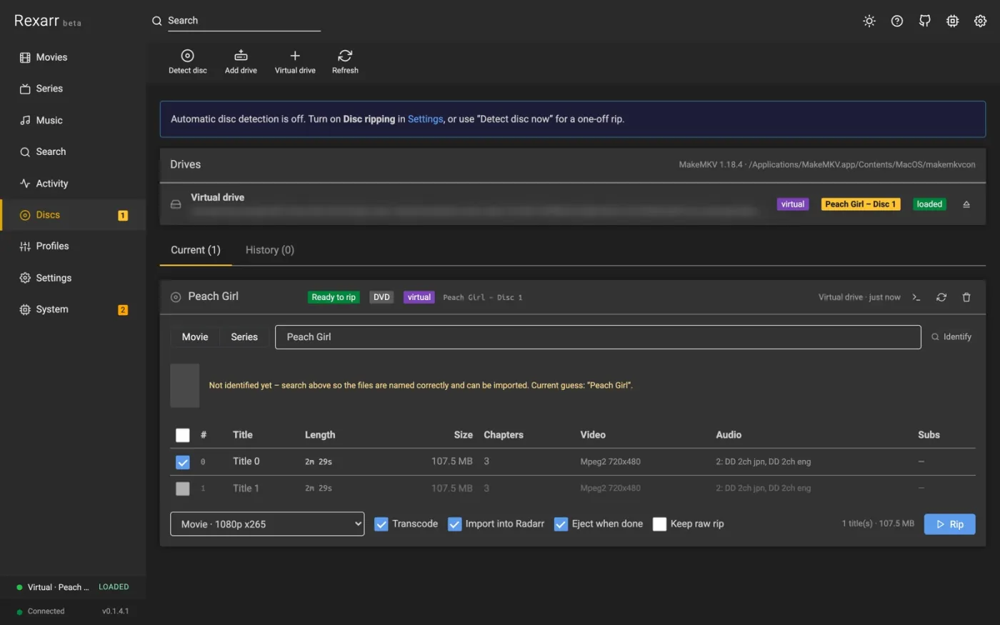
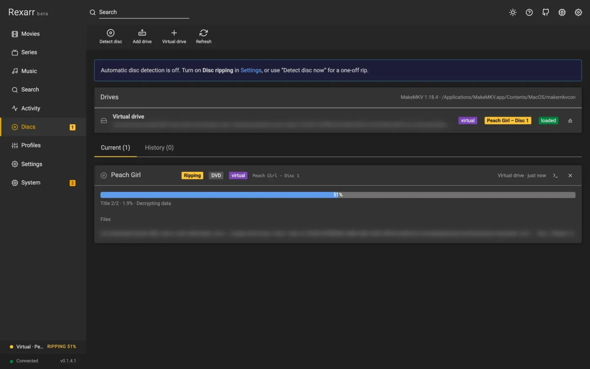

# Disc ripping

<div class="rx-shots" markdown>

<figure markdown>
{ decoding=async }
<figcaption>DVD scanned by MakeMKV, titles and tracks</figcaption>
</figure>

<figure markdown>
{ decoding=async }
<figcaption>Ripping in progress</figcaption>
</figure>

</div>

Rexarr behaves like an automatic ripping machine: insert a disc, it identifies it against your library, rips the
titles you want with MakeMKV, encodes them with a profile, and hands the finished files to Radarr / Sonarr —
checking that they really were imported. ([How it compares](../comparison.md) to ARM itself.)

**Settings → Disc ripping** is on by default. It does nothing until a disc is inserted, and it needs
[MakeMKV](https://www.makemkv.com/) (`makemkvcon`); Rexarr auto-detects the macOS app bundle and
`/usr/bin/makemkvcon`. In Docker, see [MakeMKV and Docker](makemkv-in-docker.md) — the published image does not
carry MakeMKV.

## The pipeline

1. **Detect** — Rexarr polls the drives through `makemkvcon` (every *Drive poll interval*) and creates an entry on
   the **Discs** page.
2. **Scan** — the title list is read. Titles shorter than *Minimum title length* are skipped unless
   [extras](#specials-and-extras) are included. Each title shows its length, size, audio tracks and subtitles, the
   estimated rip size and — when *Transcode* is on — the estimated size after encoding. A
   [smart profile](profiles.md#smart-profiles) is sized too: it is decided per title against what MakeMKV found,
   and the line says what it settled on (*"libx264 CRF 20 tune animation + aac"*), naming both where two titles
   on the same disc settle differently.
3. **Identify** — the disc label is matched against your library and, if needed, Radarr / Sonarr / AniDB lookups.
   You can correct the match, set season and first episode number, and choose which titles to rip.
4. **Rip** — MakeMKV rips each selected title **into Rexarr's local cache**, named so the \*arr apps parse it
   (`Title (Year) DVD.mkv`, `Show - S01E01 - Bluray-1080p Remux.mkv`).
5. **Encode** — optionally the rips are queued for transcoding with a profile, still in the cache (the raw rip is
   removed afterwards unless *Keep raw* is on).
6. **Move** — only finished files are moved to the **rip directory**, copied under a temporary name and renamed when
   complete, so a half-written file is never visible to anything else.
7. **Deliver** — the files are handed to Radarr / Sonarr by **Manual Import**, with the movie or the episodes
   stated, and every file is verified afterwards. The disc is ejected if *Eject when done* is on.

With *Start ripping automatically once identified* (auto rip) on, steps 3–7 run without confirmation.

!!! note "Why ripping happens in the cache"
    Raw MakeMKV output used to be written straight into the rip directory, so a rip that failed before encoding left
    uncompressed files there for the [rip-folder sweep](#importing-what-is-left-in-the-rip-folder) to import. Since
    0.1.6.0 nothing reaches the rip directory until it is finished.

## Drives

Rexarr lists the drives MakeMKV reports, **and any others the machine has**. MakeMKV does not always see a drive —
a USB enclosure it calls *Unsupported*, one passed into Docker without its `/dev/sg` node, or MakeMKV not being
installed yet — and saying *no optical drive* when there is one in the machine is the wrong answer. Those are added
to the list on their own, marked **found**, with the same tray state and label as any other. On macOS a drive with
nothing in it has no device path until a disc is inserted, so it is listed as *empty* and the path appears with the
disc.

For a drive neither of those finds, or to pin one to a stable path or give it a name, use **Discs → Add drive** and
enter the device path:

| Platform | Device path |
| --- | --- |
| Linux | `/dev/sr0`, `/dev/cdrom`, or a stable `/dev/disk/by-id/…` path |
| macOS | `/dev/disk4` |

The dialog lists the optical devices it finds. Rexarr then checks the tray itself (Linux `/sys/block/srN`, macOS
`drutil`), reads the label with `blkid` / `diskutil`, and rips through MakeMKV's `dev:` source. In Docker pass both
nodes (`--device /dev/sr0 --device /dev/sg0`). A configured drive that is missing shows up under **System → Status**.

Ejecting uses `drutil` on macOS and `eject` on Linux. Drives are checked one at a time, and never while MakeMKV is
using a disc — which does not stop several discs ripping at once; see [Several drives](#several-drives).

!!! tip "macOS mounts DVDs automatically"
    macOS mounts a DVD as soon as it is inserted, which leaves MakeMKV only its "OS access mode" — that fails on
    most discs. Rexarr unmounts the volume (the disc stays in the drive) before scanning and ripping.

### Several drives

Rexarr rips from as many drives as you have, at the same time:

- Every loaded drive gets **its own entry** on the Discs page, and each one is scanned without waiting for the
  others. With *Start ripping automatically once identified* on, each disc starts ripping as soon as **its own**
  scan is ready.
- **Rips run in parallel.** Each one writes into a folder of its own, because MakeMKV names the files itself and
  two rips must not land in the same place.
- A disc that has finished and is still in the tray is not ripped again until it is swapped, and a drive whose
  label reads blank for a moment after reconnecting does not produce a second entry.

Two things are deliberately not parallel:

- **Listing the drives.** Asking MakeMKV what drives exist makes it query every one of them, which disturbs a scan
  or a rip in flight, so Rexarr keeps the list it already has until the drives are idle. A disc put in while
  another is ripping can therefore take a poll or two to appear.
- **Encoding.** However many discs rip at once, their transcodes queue behind
  **Settings → Encoding → FFmpeg → Encodes at a time**. On a four-core machine, ripping two discs while one encode
  runs is usually the sensible shape; see [Requirements](../getting-started/requirements.md#hardware).

In Docker, pass **both nodes of each drive**: `--device /dev/sr0 --device /dev/sg0 --device /dev/sr1 --device
/dev/sg1`. Drives on the same USB bus share its bandwidth, so two rips from one hub are slower than two from
separate ports.

### What a drive can read

Each drive is labelled with the best format it reads — **DVD only** or **Blu-ray** — taken from the name MakeMKV
gives it, which is the format the drive writes.

That settles one question and not another:

- **A drive with no Blu-ray in its name cannot read a Blu-ray at all**, never mind a 4K UHD one. When a Blu-ray
  gives no titles in a DVD drive, Rexarr says so outright rather than listing the usual causes — no MakeMKV key
  or firmware will make a DVD drive read a Blu-ray.
- **Whether a Blu-ray drive also reads 4K UHD depends on its firmware**, and nothing in the drive's name says.
  Most cannot; the ones that can are usually on a deliberately older version. So Rexarr names UHD as the likely
  reason when a Blu-ray gives nothing and points at [MakeMKV's forum](https://forum.makemkv.com/), which keeps
  the list of which drives work — it does not guess from the model, because a wrong "your drive cannot do this"
  stops you trying the thing that would have worked.

### Drives that come and go

Two USB optical drives are more than a bus-powered hub can feed. A drive short of power does not fail cleanly: it
drops off the bus and re-enumerates, and what you see instead is MakeMKV reporting *NOT READY* or *Unknown
device*, drives appearing and disappearing from the list, or a disc that will not open however many times you try.

Rexarr cannot fix a drive that is not there, so check the machine rather than the app first. On macOS:

```bash
drutil list                       # the drives macOS itself can see
ioreg -p IOUSB -w0 | grep -c "+-o"   # how many USB nodes exist at all
```

An empty `drutil list` while a disc is in the tray means the drive is off the bus. A USB device that keeps
reconnecting leaves a node behind each time, so a registry full of them — dozens at the same address — is the
signature of a drive that has been dropping out, and those stale entries clear on a reboot.

The fix is power, not software: plug each drive **straight into the machine**, or into a hub with its own power
supply, and use the drive's Y-cable if it came with one. One drive per port.

### Virtual drives

A disc image behaves exactly like a disc:

- **Discs → Virtual drive** adds an `.iso` / `.img` file or a `BDMV` / `VIDEO_TS` folder (the folder itself or its
  parent) as a persistent virtual drive with an optional label. It shows next to the real drives, is picked up by
  the poller like an inserted disc (so auto rip works), and *eject* removes the link without touching the file.
  *Rip once* in the same dialog rips an image without keeping the link.
- **Settings → Disc ripping → Virtual drives folder** turns a whole folder of images into always-loaded virtual
  drives. Mainly a testing aid — see [Development](../development.md#test-bench).

MakeMKV decrypts commercial DVDs on its own; Blu-ray images need a registered or current beta MakeMKV key.

## Identifying the disc

Disc labels are terse (`SNAFU_2_DISC_1`, `NARUTO_S1_D2`, `MOVIE_DISC`). Rexarr:

1. matches the label against **your own library first** — Radarr and Sonarr titles, alternate titles and
   [AniDB](anidb.md)'s name for each season — so `SNAFU_2_DISC_1` becomes *My Teen Romantic Comedy SNAFU*, season 2
   ("SNAFU Too!");
2. reads a trailing number, `S2`, `II` or `2nd Season` as a **season**;
3. scores search results instead of taking the first hit;
4. ignores labels made only of generic words (`MOVIE_DISC`, `BONUS`, `DISC1`) rather than matching a library title
   by those words alone;
5. asks **OMDb** last, when it is switched on (**Settings → Connections → Metadata**). A TMDB or TVDB search
   wants something close to the catalogue title, and OMDb is better at the other end — a short, slightly wrong
   label. What comes back is the proper title and an IMDb id, which goes straight to Radarr or Sonarr so the
   match is exact rather than another guess. Its answer is scored like any other, and if neither \*arr app knows
   the title, OMDb's own name and year still go on the rip — better than *could not identify*.

A label saying **Part 2** or **P2** is read as disc 2, the way *Disc 2* is — anime box sets use one word, film sets
another, and a 32-character disc label often has room for neither. A label that opens with the distributor who
pressed it (*"Anime Limited Sword Art Online 2 P1"*) is tried again with its leading words dropped, one at a time,
and the match says what it ignored; dropping words always loses to a match on the whole label, and at least two
words have to survive, so *Anime Limited* on its own matches nothing. Rexarr cannot tell how many episodes were on the earlier discs of a set, so the page says so and asks you
to set **First ep.** rather than quietly numbering from 1.

### Labels that are not English

A volume label cannot hold much: no accents, no spaces, often only capitals. So a disc of *Für immer* is pressed
as `FUER_IMMER` or `FUR_IMMER` depending on the plant, and *Das weiße Band* as `DAS_WEISSE_BAND`. Both spellings
are tried against the library — the one with the umlaut written out and the one with it dropped — so either kind
of disc finds its title. Contracting runs only in that direction on purpose: turning `ue` back into `ü` would
make *Queen* into *Qun*.

Japanese, Korean and Chinese labels are matched as themselves. They were not matched at all before — the
matching kept only `a-z0-9` and everything else fell on the floor, so two identical Japanese titles scored
nothing against each other. Romaji with macrons (*Jūjutsu Kaisen* against `JUJUTSU_KAISEN`) already worked and
still does.

A trailing bare number is left in the title rather than read as a disc — `NARUTO_01` is *Naruto 01* — because it
is as often a sequel as a volume. `D1`, `DISC_1`, `PART_2`, `VOL_01` and `S2_P1` are all read as the disc and
season they are.

### RexDB

Before any of that, Rexarr asks [RexDB](https://moonlightlaboratory.github.io/rexarr/rexdb/) — a shared, public
database of which episode is on which part of which disc. A disc is recognised by its **fingerprint**: the volume
label and the lengths of its titles, which are known the moment a scan ends, so nothing has to be scanned or
typed. An exact match is applied and the page says the numbers came from RexDB rather than from a guess.

Anything less than exact is offered rather than applied. A drive that reads a duration a second out, or reports
the label differently, produces a different fingerprint for the same disc; where the structure still lines up
Rexarr says so and leaves the numbers to you. A disputed entry is never applied either. Whatever you set by hand
always wins.

Looking a disc up **sends nothing anywhere** — and not only in the sense that nothing is uploaded. The whole
index is downloaded and matched on your machine, so the fingerprint never leaves it: nobody can see which discs
you own, or that you looked. It is one JSON file, cached for a day. It can be switched off, or pointed at your
own copy, under **Settings → Connections → RexDB**.

### Contributing a disc

Correcting a disc's episodes is the work RexDB exists to collect, so Rexarr offers to send it back. What goes is
the disc and what is on it — its fingerprint, label, series id and episode mapping — and nothing else: no paths,
no library, nothing about you or the machine.

**Settings → Connections → RexDB** decides when:

| | |
| --- | --- |
| **Send it when the rip starts** | the default. Sent once the mapping is settled, without asking again |
| **Offer to send it** | the Discs page shows exactly what would go and you press the button |
| **Never send anything** | reading stays one-way |

Either way a submission becomes a **pull request** that somebody reads, so nothing you send is applied to anyone
else until it is agreed, and the checker runs on it first.

Out of the box there is **no submission service set**, and nothing is posted from your machine: the Discs page
hands you the entry and a GitHub link, and you post it. That needs nothing deployed by anyone. Setting
**Submission service** to a [Worker](https://github.com/MoonlightLaboratory/rexarr/tree/RexDB/worker) — the
public one, or your own — is what makes a corrected disc go on its own. The Worker holds the GitHub token so
Rexarr never carries a credential that could write to the database.

Where RexDB has never seen the disc, Rexarr falls back to what it can work out:

Where disc 2 and later **start** cannot be read off the disc, and Sonarr cannot help once a season is complete —
every episode has a file either way. Rexarr carries on from the earlier discs of the same set when it has ripped
them; otherwise it assumes each disc held as many episodes as this one. Both are guesses and the page says so,
with the number it guessed, until you set **First ep.** yourself. It matters: a set is often 7 + 7 + 5 + 5 rather
than four equal discs.

Whether episodes are numbered **S01E01** or absolutely (*Show - 033*) follows **Sonarr's own series type**, not
whether AniDB knows the show: a series Sonarr files as *standard* is named `S02E08` even when it is anime, because
that is what its library and its importer expect.

**Match again** re-runs identification on a disc that was matched wrongly, and you can always pick the title
yourself. For a series, set the **season** and the **first episode number**; absolute numbering is used for anime
when AniDB says so.

## Titles, episodes and order

Each title gets a role in the **Episode / extra** column:

- an **episode** of the season (numbers beyond the season's last episode are flagged *special or extra?*),
- a **special** from season 0 — listed when TVDB has specials for the show — imported by Sonarr as `S00Exx`,
- an **extra**: *OP*, *ED*, *Extra*, *OVA*, *Special*, a **custom** name, or the disc's own title name.

For a multi-disc set, disc 2 continues after disc 1's episodes (see [Box sets](#box-sets)); disc sets rip into
`Show (Year) - Disc N` folders so parallel rips never mix files.

### Specials and extras

Sonarr and Radarr only import episodes and movies, so extras go into an `Extras` folder next to the show or movie
(Plex, Jellyfin and Emby show them there), named like `My Teen Romantic Comedy SNAFU - S02 - OP.mkv`.

Short titles (a creditless OP / ED runs about 90 seconds) are skipped by the minimum title length. Tick
**Settings → Disc ripping → Include extras and specials** to list them too, down to *Shortest extra* (30 s by
default); they start out as extras, with 60–150 s titles guessed as OP then ED.

### Audio tracks

Discs often carry the same language several times — DTS 5.1, Dolby Digital 5.1 and a stereo track. **Best audio per
language** (the default, **Settings → Disc ripping**) keeps the best one per language: lossless first (TrueHD,
DTS-HD MA, LPCM, FLAC), then DTS over Dolby Digital, then more channels, then the higher bitrate; commentary tracks
are never the automatic pick.

Tick the tracks you want per title in the **Audio** column — several at once is fine — and *Apply to all titles*
copies that choice to every episode on the disc.

Tracks that are not kept are dropped from the ripped MKV by a stream copy (no re-encode), which also shrinks the
file before it is transcoded: on a Naruto DVD, 6 audio tracks down to 1 took a title from 1.58 GB to 1.21 GB.

## Box sets

A season that came on four discs is one thing, not four. When a disc is identified as the same series and season
as a disc already in the queue, it offers to join it:

> Part of a set? Add this disc to **Naruto - Season 1 box set**?  **[Add to set] [Keep separate]**

It asks rather than assuming. Two discs of one season are usually a set, but not always, and a disc filed in the
wrong one takes its episode numbers from the wrong place. A *no* is remembered, so the disc is not asked twice,
and a disc can be taken out of a set later with **Remove** on its row.

The set is the parent item, with each disc inside it:

- **Disc 2 · E06 to E09 · 4 episodes · Waiting** — a disc reads as the episodes on it, not as `title_t03`.
- Opening a disc lists those episodes **by name** from Sonarr, above the disc's own controls.
- Each disc keeps its own state — *waiting*, *ripping*, *remuxing*, *done* — and the set shows progress across
  all of them.
- Discs that have not turned up yet are listed as **incoming**, so what is still missing is visible without
  counting.
- Episode numbers carry on from the disc before: disc 2 starts at E06 when disc 1 held five episodes. A number
  worked out this way is marked *guessed*, because nothing on a disc says how many were on the ones before it.

How many discs a set holds is worked out from the season's episode count and what its discs actually hold — 35
episodes at four or five a disc is eight discs — and **Discs…** sets it by hand when that is wrong. **Rename**
changes the set's name.

A set is only ever its discs. There is no list of sets kept anywhere: one appears with its second disc, goes when
its discs go, and leaves nothing empty behind. Turn the whole thing off with **Group multi-disc sets into box
sets** in [Settings → Disc ripping](../reference/settings.md#disc-ripping).

### Swapping discs through a set

**Swap** appears on a drive as soon as its disc has been **copied** — not when the encode finishes. Remuxing reads
the copy on disk, so holding a tray shut for the length of a transcode would idle the drive for nothing.

One press ejects the tray and the drive says what to put in next:

> Waiting for Disc 3 of Naruto - Season 1 box set

Close the tray and the disc is read and dropped into that slot. While a drive is still reading, its **Swap** is
greyed out.

**Swap all finished** in the toolbar does every drive whose disc has been copied in one pass, so a whole stack can
be pulled and reloaded together. Each drive is given a different disc to wait for, rather than both asking for
disc 3.

#### When the disc is not the one expected

Nothing is filed by force. A disc that is not what the drive was waiting for says so and offers a choice:

| What went in | What it says |
| --- | --- |
| Another series | *This reads as Bleach season 1, not Naruto - Season 1 box set.* |
| A disc of the set that is already here | *Disc 3 of Naruto - Season 1 box set is already here.* |
| A different disc of the same set | *The drive was waiting for disc 3 and this reads as disc 5.* |

Each offers **Add as Disc N**, **Assign to a slot…** or **Reject — keep it separate**. A disc that matches no
series at all is simply a new queue item, as it always was.

## Which disc to go and find

Another experiment (**Settings → Experiments**): **Insert disc for…** on the Discs page lists what Radarr and
Sonarr are still hoping to improve, with the kind of disc that would actually improve it — so the shelf becomes an
upgrade queue. See [Settings → Experiments](../reference/settings.md#ripping-to-do-list).

## Scanning a barcode instead of waiting for the disc

An experiment (**Settings → Experiments**, off by default): scan the barcode on the case with your phone and Rexarr
resolves the release, adds it to Radarr / Sonarr and remembers that the disc is coming, so it is already in the
library when you put it in the drive.

Barcodes go to [TheDiscDB](https://thediscdb.com) first, where a hit is the exact release with its ids; then
MusicBrainz for a CD; then UPCitemdb, which returns a shop listing rather than a title (*"Reign Of The Supermen
(4k Ultra Hd + Blu-ray + Digital) Sealed With Slipcover"*). The edition noise is stripped off, and with **OMDb**
switched on, what is left is checked against it — so the shop's product name becomes a real title, year and IMDb
id before anything is added to Radarr or Sonarr. See
[Settings → Experiments](../reference/settings.md#barcode-scanning) — including why the camera needs HTTPS.

## Adding missing shows and movies

Some discs are for titles you have not added yet. With **Add shows and movies to Sonarr / Radarr when their disc
starts ripping** (on by default) Rexarr adds them — or do it before ripping with **Add to Sonarr now** on the Discs
page, which also lets you pick episodes by name.

- The title goes into the **root folder and quality profile your library already uses for that kind of title** —
  TV, anime, movies, anime movies — worked out from where your existing titles live and which profile most of them
  use. Folders that look like staging areas (`downloads`, `temp`, `incomplete`, `rips`) are never chosen.
- Override any of them under **Settings → Disc ripping → Where added titles go**.
- Added titles are **not monitored** by default, so adding a show to import one disc never starts downloading the
  rest of the season. Tick *Monitor what was added* if you do want Sonarr / Radarr to fill in the gaps and upgrade
  the rip.

## Delivery and import

The rip directory must be reachable by Radarr / Sonarr. **Settings → Disc ripping → Check import access** asks both
apps — through their own file browser, with your [path mappings](../reference/settings.md#path-mappings) applied —
whether they can see it, so a rip that cannot be imported is caught before the first disc.

When a rip finishes, Rexarr:

1. checks the folder is visible to the app as it will be sent (after path mappings);
2. sends a **Manual Import** stating the movie, or each episode, with DVD rips imported as DVD quality;
3. waits for the import command and then **verifies** it: the file has to be gone from the rip folder *and* the
   movie / episodes have to have a file in Radarr / Sonarr;
4. writes the result for every file into the disc log.

!!! warning "A command that completed does not mean a file was imported"
    Radarr and Sonarr report their import commands as `completed` even when they imported nothing. If nothing was
    imported — or only some of the files were — the rip **fails** with what happened, both paths and where the files
    are, instead of reporting success. The ripped files are kept.

    ```
    status: failed
    error:  Radarr cannot see /nonexistent/rips/Dune (2021) (this computer:
            /Volumes/Media/Rips/Dune (2021)) – fix the rip directory or its path
            mapping. The files are there and can be imported from
            Settings → Disc ripping.
    ```

    Fix the mapping and the files can still be imported — the rip then goes back to *done*.

### Subtitles with Bazarr

With **Settings → Connections → Bazarr** filled in, a disc that has just been imported is handed straight to
Bazarr: look at the disk again, because the file is new, then search for whatever subtitles are still missing.
Without it, Bazarr finds the file when its own schedule next comes round.

Rexarr already knows the two things Bazarr needs — whether this was a film or a series, and its Radarr or Sonarr
id — because that is what it just handed the files to.

Bazarr is told, not asked. One that is down, misconfigured or answering something unexpected is written to the
disc's log and to **System → Events**, and the rip carries on: a missing subtitle does not make a good rip a bad
one.

### Importing what is left in the rip folder

**Import finished rips automatically** (on by default) hands anything still sitting in the rip folder to Radarr and
Sonarr every 10 minutes — a failed import, files you copied there by hand. **Import rip folder now** (Settings →
Disc ripping) does it immediately and lists what happened to each file. Folders are only touched once they have
stopped changing, and empty folders are tidied up afterwards.

!!! danger "Do not make the rip folder a root folder"
    If the rip directory is also a Radarr / Sonarr **root folder**, the app can take ownership of files there, and
    with its recycle bin off a replaced file is deleted permanently. Keep rips in their own folder outside your
    library roots.

## Keeping the computer awake

Ripping and encoding a disc takes hours, and a laptop or PC that sleeps in the middle of it leaves a broken file.
With **Keep this computer awake while ripping or encoding** (Settings → Encoding, on by default) Rexarr holds a
sleep inhibitor for as long as a scan, rip or encode is running, and releases it when nothing is:

| Platform | How |
| --- | --- |
| macOS | `caffeinate -i -s -m -w <pid>` |
| Windows | `SetThreadExecutionState(ES_CONTINUOUS \| ES_SYSTEM_REQUIRED)` from a hidden PowerShell process watching Rexarr |
| Linux | `systemd-inhibit` (`idle:sleep:shutdown`) |
| Docker | not attempted — the host's power settings decide |

The display is allowed to sleep; only the machine is kept awake. **System → Status** shows whether an inhibitor is
held and why.

## Full-disc releases from search

Search shows a **Remux / Remux + Disc / Disc / ISO / All** filter (the default follows *Settings → Encoding →
Defaults*). Disc releases get a purple *Blu-ray ISO / disc*, *UHD Blu-ray* or *DVD* badge.

A release counts as a full disc from its title or its \*arr quality: `COMPLETE … BLURAY` with the resolution and
format in between (`COMPLETE.UHD.2160p.BLURAY`, `COMPLETE.2160p.UHD.BLURAY`, `4K.UHD.COMPLETE.BLURAY`), `BD25` /
`BD50` / `BD66` / `BD100`, `BD-ISO`, `BDMV`, `BR-DISK`, and for DVDs `DVD5` / `DVD9` / `DVDR` / `VIDEO_TS` /
`DVD ISO`. A remux of a disc is not a disc, and neither is a finished series: *Complete 1-96 S01 1080p BluRay* is
an episode pack, and only the words a disc release puts between *complete* and *blu-ray* count.

Grabbing one:

1. sends it to Radarr / Sonarr as usual and creates a job that follows the download in the app's queue
   (*Downloading full disc · 62%* in Activity);
2. when the download completes (Radarr / Sonarr cannot import it and leave it *import pending*), Rexarr maps the
   queue item's `outputPath` through the path mappings and looks for `.iso` / `.img` files and `BDMV` / `VIDEO_TS`
   folders up to three levels deep (samples skipped). Multi-disc packs become one rip per disc;
3. each disc opens on the **Discs** page already matched to the movie / series, with the profile picked at grab
   time. Movies rip straight away; series wait for you to check the title → episode order;
4. after transcoding the files are imported as above, and once the last disc is done the stuck download is removed
   from the \*arr queue (`removeFromClient=false`, so torrents keep seeding).

Requirements: MakeMKV (Blu-ray ISOs need a registered or beta key), a path mapping for the download client's folder
(for example `/downloads` → `/mnt/downloads`), and a rip folder the \*arr apps can reach. Prowlarr grabs are
untracked — open the finished ISO with **Discs → Virtual drive**. If Radarr imports an `.iso` itself, Rexarr rips
that file instead.

## Audio CDs

**Discs → drive → ♫ Read audio CD** rips music CDs with fre:ac instead of MakeMKV, with MusicBrainz metadata and
cover art. See [Music → Audio CDs](music.md#audio-cds).

## Troubleshooting

| Symptom | Cause and fix |
| --- | --- |
| *No titles found on this disc* | The disc page says which of the two it is, and quotes MakeMKV: either titles were found but all were under *Minimum title length*, or none were found at all — the MakeMKV key (Blu-ray needs one), a drive whose firmware cannot decrypt the disc, or, in Docker, the drive's `/dev/sg` node not passed through next to `/dev/sr0` |
| Nothing is imported, rip says *cannot see …* | The rip directory is not visible to the app at that path — fix **Settings → Path mappings** or the rip directory, then *Import rip folder now* |
| Some files imported, others not | The error names each file; usually a rejection (sample, unknown episode) — the disc log has the app's own reason |
| Episodes land on the wrong numbers | Set season and first episode before ripping; check the title order in the Episode column |
| A title is missing from the list | It is shorter than *Minimum title length* — lower it or tick *Include extras and specials* |
| Titles change number between scan and rip | Scan and rip use the same minimum length; if you changed it, scan again |
| *MakeMKV could not open the disc* | The message says which it is, in MakeMKV's words. **The drive is not ready** — it was still coming up to speed when the disc was read; Rexarr waits and tries once more on its own, so a second failure means the drive cannot read this disc. **MakeMKV did not find that drive** — it is busy, not ready, or no longer connected. **The image may be incomplete** — an `.iso` that is not a video disc. On macOS it can also still be a mounted volume, which Rexarr unmounts before reading |
| A drive holds a disc but Rexarr lists no drives | Rexarr lists the drives MakeMKV lists, including empty ones. If MakeMKV lists none either, the drive is off the bus rather than missing from Rexarr — see [Drives that come and go](#drives-that-come-and-go) |
| The same drive appears twice | A drive MakeMKV reports both as an empty slot and with its disc, or one Rexarr found itself while MakeMKV had not listed it. Both are collapsed to one drive; if you still see two, **Refresh** |
| Drive is not listed | **Discs → Add drive** with the device path; in Docker pass `/dev/sr0` **and** `/dev/sg0` |
| MakeMKV is missing or will not start | **System → Status** says why (wrong architecture, not executable, not found) |
