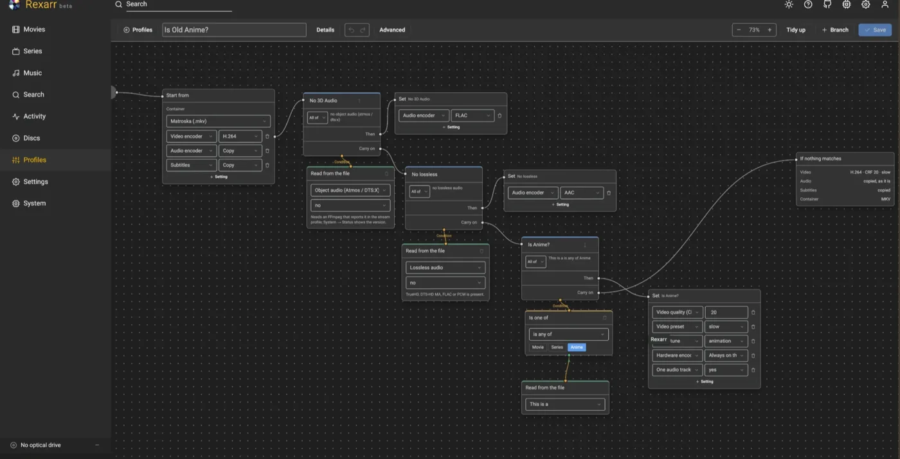

# Profiles

{ decoding=async }

A profile is a complete description of one encode: container, video, audio, subtitles and output handling. Every job
uses exactly one profile. The built-in presets cannot be edited — **clone** one and change the copy.

## Video

| Field | What it does |
| --- | --- |
| **Encoder** | x264, x265, SVT-AV1, libaom-AV1, VP9, NVENC / QuickSync / VAAPI / AMF / VideoToolbox / RKMPP / V4L2 variants, or **copy** (no video re-encode) |
| **Quality** | CRF for x264 / x265 / SVT-AV1 / libaom / VP9; translated to CQ, QP, `global_quality` or `-q:v` for hardware encoders |
| **Preset** | Software: `ultrafast`…`placebo` (x264 / x265) or `0`–`13` (SVT-AV1). Hardware: `p1`–`p7` / speed levels |
| **Tune** | none, animation, film, grain, fastdecode, zerolatency |
| **Pixel format** | auto, `yuv420p` (8-bit), `yuv420p10le` / `p010le` (10-bit), `nv12` |
| **Max height** | downscale so the height fits (0 keeps the source resolution) |
| **HDR passthrough** | keep HDR10 colour metadata when the source is HDR |
| **Bitrate** | kbps, for encoders and modes that are bitrate-based (0 = quality based) |
| **Extra args** | raw ffmpeg arguments appended after the video options |
| **Software only (CPU)** | ignore the hardware acceleration set in Settings for this profile |

### Letterbox bars

**Letterbox bars** in a profile's Video section removes the black above and below a 2.39:1 film, so the bitrate
goes on picture instead of black.

| | |
| --- | --- |
| **Keep them** | nothing is cropped (the default) |
| **Remove automatically** | the file is measured and cropped only if the samples agree |
| **Crop exactly…** | `width:height:x:y`, on every file the profile encodes |

Automatic measures a few seconds in five places spread across the file, skipping the logos at the start and the
credits at the end, and crops only when at least four fifths of what it saw agrees. **A film whose shape changes
partway through — an IMAX sequence, an open-matte insert — is left alone**, and the disc's log says so rather
than quietly cropping into the taller scenes. A handful of pixels is not letterboxing either, so a few stray
black lines are left as they are.

The crop happens before anything else, so a downscale is measured against the real picture rather than against
the black.

*Crop exactly* is the override when the measurement is wrong, or when you already know the numbers: it is applied
as typed and nothing is measured. `ffmpeg -i file -vf cropdetect -f null -` prints them in that form.

## Audio

| Field | What it does |
| --- | --- |
| **Encoder** | copy, AAC, Opus, E-AC-3, AC-3, FLAC, TrueHD (plus LAME MP3, Vorbis, WavPack, Monkey's Audio for music profiles) |
| **Bitrate / channels** | kbps per stream; channels 0 (keep), 2, 6 or 8 |
| **Languages** | ISO 639-2 codes to keep, e.g. `jpn`, `eng`. Empty keeps all |
| **Tracks per language** | *Keep them all*, or one of them: the **best**, the **smallest**, or the **first** in the file |
| **Drop commentary** | skip tracks whose title says commentary |

A disc almost always carries a language more than once — DTS-HD MA 5.1 beside Dolby Digital 2.0, or the same mix
in two codecs — and **Tracks per language** is how to be rid of the extras. *Best* and *smallest* rank a track the
way [disc ripping](disc-ripping.md#audio-tracks) does: codec first (TrueHD, DTS-HD MA, LPCM, FLAC, then DTS over
Dolby Digital), then channels, then bitrate; a commentary track is never the pick either way. *First* is whichever
the file happens to list first, which is what Rexarr did before this was a choice.

Dropping a track here happens at the encode, so it works on files you already have as much as on a fresh rip, and
the size estimate counts it. For a disc you are about to rip, **Settings → Disc ripping → Best audio per
language** does the same thing earlier, and leaves less to carry about.

Music profiles add VBR quality, maximum sample rate, bit depth, FLAC compression level, ReplayGain, embedded cover
and *Keep MQA intact* — see [Music](music.md).

## Subtitles

**Copy** everything, **copy text only**, **burn in** (choose the language, optionally preferring forced tracks), or
**none**. *Keep fonts* copies MKV font attachments, which anime subtitles need.

### Picture subtitles

A DVD, a Blu-ray and a DVB recording carry their subtitles as pictures — `dvd_subtitle`, `hdmv_pgs_subtitle`,
`dvb_subtitle` — not as words. Nothing in FFmpeg turns a picture into text, so they cannot be converted by
changing the codec, and MP4 and WebM, which cannot hold them at all, simply lose them.

**Picture subtitles** decides what happens to them:

| | |
| --- | --- |
| **Keep as pictures** | copy them as they are, where the container can carry them. The default |
| **Read into text (OCR)** | read them with Tesseract and keep the text instead |
| **Read into text, keep the pictures too** | both, which an MKV has room for |

Reading them turns a disc's subtitles into real SRT: searchable, stylable, and small enough that an MP4 or a
WebM keeps them rather than dropping them. It needs [Tesseract](https://tesseract-ocr.github.io/) and a language
model for each subtitle language — `brew install tesseract`, `apt install tesseract-ocr tesseract-ocr-eng`, or
the Windows installer. The System page says whether it is there and which models it has, and warns if a profile
asks for OCR without it.

**Settings → Tesseract** is the switch for the whole of Rexarr, and holds the path (empty to find it where it
usually lives). Turned off, every profile's choice here is ignored and picture subtitles are copied as they
are — the job log and the command preview say so rather than going quiet.

It happens before the encode, since it cannot happen inside it, and it is slow: minutes for a feature, written
into the job log as it goes (*"412 lines read from 1,074 pictures in 96s"*). How well it reads depends on the
disc — a clean white-on-black DVD font is close to perfect, a stylised one is not — so read the result before
you delete the source. A track that cannot be read, or a language Tesseract has no model for, is noted in the
log and left as pictures; it never fails the encode.

Each track keeps its own language and its forced flag, and is named *English · OCR* so it is obvious where it
came from.

## Output

| Field | What it does |
| --- | --- |
| **Directory** | empty = next to the source file |
| **Suffix** | appended to the file name before the extension |
| **Replace original** | delete the source after a successful encode |
| **Rescan in \*arr** | ask Radarr / Sonarr to rescan when the encode finishes |
| **Rename for the encode** | rewrite release tokens in the name so it no longer claims to be a remux |
| **Write clean metadata** | file title, track titles, default track, no stale source tags |

## Built-in presets

| Video | Music |
| --- | --- |
| Anime · x265 10-bit | Music · Keep as downloaded |
| Anime · SVT-AV1 | Music · FLAC (lossless, keeps MQA) |
| Movie · 4K HDR x265 | Music · FLAC 16/44.1 (CD quality) |
| Movie · 1080p x265 | Music · WavPack (lossless) |
| Movie · Film grain x265 | Music · MP3 V0 (LAME) |
| TV · 1080p x265 | Music · MP3 320 (LAME) |
| Web · H.264 MP4 | Music · Opus 160k |
| Fast · HEVC VideoToolbox | Music · Ogg Vorbis q6 |
| Fast · HEVC NVENC | |
| Remux · Keep video, Opus audio | |
| Remux · Keep video, FLAC audio | |

Only open-source audio encoders are offered (no FDK-AAC, no Apple / Nero AAC); old profiles that used `libfdk_aac`
fall back to FFmpeg's native AAC with a warning.

## Smart profiles

A **smart profile** is a profile. It has its own settings and encodes with them — there is no second profile
behind it. What makes it smart is that some of those settings are decided from the file in front of it, which is
the only way to answer the questions worth asking: whether a disc's lossless track is stereo or 7.1, whether its
audio carries Atmos or DTS:X, whether what you are encoding is animation.

It can be chosen anywhere a profile can — the per-kind defaults in **Settings**, a rip's profile on the Discs
page, auto transcode. The decision is made per file, so each episode of a series is judged on its own.

### How it decides

Every encode starts from the profile's own settings. Each branch is then checked in order, and **every branch
that fits applies its changes** — a later one wins where two touch the same setting. So:

```
Start from   HEVC, CRF 20, audio copied, subtitles copied
Branch 1     if the genre is Animation        → tune animation, CRF 18
Branch 2     if this is 2160p and HDR         → 10-bit, keep HDR metadata
```

An animated UHD disc takes both. A live-action 1080p one takes neither and is encoded with the settings at the
top. There is no fallback branch to write, because the settings you start from *are* the fallback.

If nothing would be re-encoded — video copied, audio copied, subtitles copied, same container — Rexarr queues no
encode at all and leaves the file alone. That is what "keep TrueHD" looks like: start from audio copied, and only
change it for the discs you want changed.

### The canvas

{ decoding=async }

**Profiles → a smart profile → Edit** opens it as a graph, filling the window beside the sidebar. **Start from**
holds the settings every encode begins with. A *Branch* asks a question and has a **Then**, which goes to a *Set*
node listing what it changes, and a **Carry on**, which continues to the next branch. A branch's **Condition**
comes up from the nodes below it — a *Comparison* fed by a *Read from the file*, or a plain read for a yes/no
question, gathered by an *All of* when a branch asks more than one thing. At the end, **If nothing matches**
shows what a file that fits no branch is encoded with.

Everything is edited in the node itself, and a branch says what it asks in its own body, so the graph still reads
when it is zoomed out. Drag nodes anywhere — where they sit is saved with the profile, **Tidy up** puts them
back — drag the background to pan, scroll or use the zoom control to resize, and the percentage button frames the
lot.

**Hold shift and drag** to draw a box over the canvas: every node it touches is selected, and dragging any one
of them moves the whole group. Shift-click a node on its own to add it to the selection or take it out again. A
click on the background, or <kbd>Esc</kbd>, drops the selection; the bar says how many are held. Dragging the
background without shift pans, as before. **Details** holds the description and what the profile is for, and
**Advanced** adds the node menu and cables — see below. Edits are kept until you press **Save**; an
*Unsaved* mark appears in the bar and leaving the page asks first.

**↶ ↷** in the bar undo and redo, as do <kbd>⌘Z</kbd> and <kbd>⇧⌘Z</kbd> (<kbd>Ctrl</kbd> on Windows and
Linux). They cover everything on the canvas — a value typed, a node added or taken away, a cable run or pulled,
a node dragged — and a run of small changes is one step, so undoing a drag puts the node back where it started
rather than walking it there.

The wires are drawn from the chain rather than dragged by hand: the order of the branches is what a smart profile
*is*, and the ↑ ↓ on a branch's header changes it.

### Advanced

Nothing is ever hidden. A branch can ask about 27 things and change 28, and every one of them is in the dropdown,
sorted under a heading — *Audio*, *Video*, *Subtitles*, *Source*, *What it is* on the asking side, *Video*,
*Audio*, *Subtitles*, *Output* on the changing side — so a long list is still something you can read down.

**Advanced** in the bar is about the canvas rather than the dropdowns. On, it adds:

**A node menu.** **+ Node** drops a node on the canvas on its own: a *Branch* (which lands at the end of the
chain, like the ordinary **+ Branch** button), a *Comparison* — a number read off the file, measured against one
of yours — or a *Yes / no*. A comparison arrives with its *Read from the file* already attached, so the field is
yours to pick straight away.

**Cables.** Every condition node grows a **⌁** button. On a condition that is wired to a branch it takes the
cable off: the node stays exactly where it is, drawn with a dashed border, and the branch simply stops asking it.
On a node with no cable it picks the cable up — the bar says *Cable in hand*, the branches' condition ports light
up and say **Plug in here**, and clicking one makes that condition one of the branch's questions. <kbd>Esc</kbd>,
or the bar's own hint, puts the cable down again.

A node with no cable decides nothing. It is not a condition that is switched off and it is not a branch that
never fires — it is simply not wired to anything, and the profile encodes as if it were not there. It is saved
with the profile, where it sat and all, so a question you are still thinking about survives a reload.

To be rid of one for good, use its bin.

Advanced is the same switch the Settings pages use, remembered the same way, and it changes nothing about how a
profile encodes.

### What a branch can ask about

| | |
| --- | --- |
| Audio | channels (the widest track in the file), codec, object audio (Atmos / DTS:X), whether anything lossless is present, languages carried, whether there is a commentary track, how many tracks, highest declared bitrate |
| Video | height, width, codec, HDR, Dolby Vision, bit depth, frame rate, whether it is interlaced |
| Subtitles | how many, languages, whether any are forced, whether any are text rather than bitmap |
| Source | running time, file size, bitrate, container |
| What it is | movie / series / anime, genres, and the year |

**What it is** comes from Radarr or Sonarr when they have the title. For anything they do not — a local file, a
disc being ripped, something queued by hand — it comes from [OMDb](../reference/settings.md) when that is
switched on, which is what makes *if it is animation, use the animation tune* work outside the \*arr apps. Either
way the lookup only happens when a branch actually asks, so a profile that never mentions genre costs nothing.

A branch wants **all of** its conditions by default; switch it to **any of** and one is enough. It can be given
a name, which is what the job log calls it, and switched **off** — the branch and its wiring stay where they are
and it is simply skipped, which is how you try something without losing it.

**Object audio** is read from the stream profile FFmpeg reports — `Dolby TrueHD + Dolby Atmos`,
`Dolby Digital Plus + Dolby Atmos`, `DTS-HD MA + DTS:X`, `DTS-HD MA + DTS:X IMAX`. Nothing else in the file says
so: a 7.1 TrueHD track is not necessarily Atmos, and no channel count settles it. An FFmpeg too old to name it
never reports it, in which case the condition is simply never true — **System → Status** shows the version. Every
decision writes the profiles it saw into the job log, so you can tell the two apart.

**Genres** come from Radarr or Sonarr, lower-cased, and are only looked up when a branch actually asks about
them, so a smart profile that never mentions genre costs no extra request.

### What a branch can change

| | |
| --- | --- |
| Video | encoder, CRF, preset, tune, downscale height, pixel format, HDR passthrough, bitrate, whether to force the CPU, extra ffmpeg arguments |
| Audio | encoder, bitrate, channels, which languages to keep, how many tracks per language, whether commentary is dropped |
| Subtitles | mode, which languages to keep, which language to burn in, forced only, font attachments, picture subtitles |
| File | container, file name suffix, output folder, replace the original, rename from the profile tokens, clean metadata, tell Radarr / Sonarr |

Anything a branch does not touch stays as the profile's own settings left it. **Start from** takes the same list,
so whatever a branch can change, a profile can also simply be.

### The two that ship with it

- **Smart · Lossless audio, the right way round** — video and audio copied, except that a *lossless stereo* track
  becomes FLAC: the same samples in less space. Surround and object audio are left exactly as they are, which
  means no encode is queued for them at all.
- **Smart · x265, and animation knows itself** — HEVC CRF 20 for everything, with animation (by genre, or a
  series Sonarr calls anime) getting the animation tune and CRF 18, since flat colour and sharp lines fall apart
  at settings that suit film grain; UHD HDR adds 10-bit and HDR passthrough.

Both are read-only. Clone one to change it.

## Command preview

The profile editor shows the exact ffmpeg command the profile produces, either against a sample UHD remux or against
a real file on disk, together with the output file name it would write. Use it before you run a 4-hour encode.

It also says what the video will come out at — **Video ≈ 9.6 Mbps · source 67 Mbps overall** — because a CRF is
not a number anyone can read a bitrate off, and that is usually the question being asked while one is being
chosen. The same line appears under *Preview command* in the transcode dialog, where it is measured against the
file you are about to encode. The figure is an estimate for a quality-mode encode and exact where the profile
sets a bitrate or copies the stream.

## Output names and metadata

An encoded remux is not a remux any more, so by default (profile → Output → *Rename for the encode*) the release
tokens in the file name are rewritten to describe the result. Radarr / Sonarr then report the real quality after the
rescan instead of Remux:

| Source | Encode (x265 10-bit, Opus) |
| --- | --- |
| `Blade Runner 2049 (2017) Remux-2160p.mkv` | `Blade Runner 2049 (2017) Bluray-2160p.mkv` (or `Bluray-1080p` when downscaled) |
| `Frieren - S01E05 - Phantoms of the Dead - Bluray-1080p Remux.mkv` | `Frieren - S01E05 - Phantoms of the Dead - Bluray-1080p.mkv` |
| `Movie.2017.2160p.UHD.BluRay.REMUX.DV.HDR.HEVC.TrueHD.Atmos.7.1-GRP.mkv` | `Movie.2017.2160p.UHD.BluRay.HDR.10bit.x265.Opus.7.1-GRP.mkv` |

Only quality, resolution, codec, audio, HDR (Dolby Vision is dropped by an encode, HDR10 kept) and bit-depth tokens
already in the name change; titles, years, ids and release groups stay.

*Write clean metadata* sets the file title (`Movie (Year)` / `Show - S01E05 - Title`), names tracks
(`2160p HEVC 10-bit HDR10`, `English · Opus 5.1`, subtitle language / Forced / SDH), marks the first audio track
default, removes stale source stream tags and adds a comment describing the encode.

## How a profile becomes an ffmpeg command

- Streams are selected explicitly by index from `ffprobe` output: one video stream, audio streams filtered by
  language (with commentary dropped), subtitles filtered by language / type, font attachments when the container is
  MKV.
- Quality is mapped per encoder family: `-crf` for x264 / x265 / SVT-AV1 / libaom / VP9, `-cq` + `-rc vbr` for
  NVENC, `-global_quality` for QuickSync, `-qp` for VAAPI / AMF, `-q:v` for VideoToolbox.
- HDR sources keep colour primaries / transfer / matrix flags and, for x265, mastering-display and content-light
  metadata. Dolby Vision RPU layers are dropped (HDR10 base layer kept) with a warning.
- MP4 / MOV get `-movflags +faststart`, `hvc1` tagging for HEVC, text subtitles as `mov_text`; bitmap subtitles and
  incompatible audio codecs are dropped or re-encoded with a warning in the log.
- Output goes to `<name>.<ext>` next to the source (or your directory / suffix), written as a `.rexarr-part` temp
  file and renamed on success. With *Replace original* the source is deleted and Radarr / Sonarr are asked to
  rescan.
