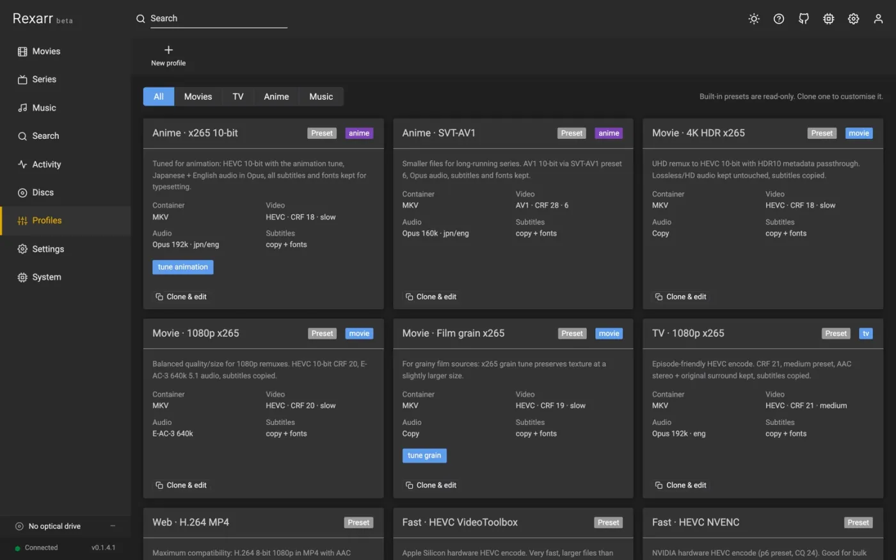

# Profiles

{ decoding=async }

A profile is a complete description of one encode: container, video, audio, subtitles and output handling. Every job
uses exactly one profile. The built-in presets cannot be edited — **clone** one and change the copy.

## Video

| Field | What it does |
| --- | --- |
| **Encoder** | x264, x265, SVT-AV1, libaom-AV1, VP9, NVENC / QuickSync / VAAPI / AMF / VideoToolbox / RKMPP / V4L2 variants, or **copy** (no video re-encode) |
| **Quality** | CRF for x264 / x265 / SVT-AV1 / libaom / VP9; translated to CQ, QP, `global_quality` or `-q:v` for hardware encoders |
| **Preset** | Software: `ultrafast`…`placebo` (x264 / x265) or `0`–`13` (SVT-AV1). Hardware: `p1`–`p7` / speed levels |
| **Tune** | none, animation, film, grain, fastdecode, zerolatency |
| **Pixel format** | auto, `yuv420p` (8-bit), `yuv420p10le` / `p010le` (10-bit), `nv12` |
| **Max height** | downscale so the height fits (0 keeps the source resolution) |
| **HDR passthrough** | keep HDR10 colour metadata when the source is HDR |
| **Bitrate** | kbps, for encoders and modes that are bitrate-based (0 = quality based) |
| **Extra args** | raw ffmpeg arguments appended after the video options |
| **Software only (CPU)** | ignore the hardware acceleration set in Settings for this profile |

## Audio

| Field | What it does |
| --- | --- |
| **Encoder** | copy, AAC, Opus, E-AC-3, AC-3, FLAC, TrueHD (plus LAME MP3, Vorbis, WavPack, Monkey's Audio for music profiles) |
| **Bitrate / channels** | kbps per stream; channels 0 (keep), 2, 6 or 8 |
| **Languages** | ISO 639-2 codes to keep, e.g. `jpn`, `eng`. Empty keeps all |
| **First match only** | keep only the first stream per language |
| **Drop commentary** | skip tracks whose title says commentary |

Music profiles add VBR quality, maximum sample rate, bit depth, FLAC compression level, ReplayGain, embedded cover
and *Keep MQA intact* — see [Music](music.md).

## Subtitles

**Copy** everything, **copy text only**, **burn in** (choose the language, optionally preferring forced tracks), or
**none**. *Keep fonts* copies MKV font attachments, which anime subtitles need.

## Output

| Field | What it does |
| --- | --- |
| **Directory** | empty = next to the source file |
| **Suffix** | appended to the file name before the extension |
| **Replace original** | delete the source after a successful encode |
| **Rescan in \*arr** | ask Radarr / Sonarr to rescan when the encode finishes |
| **Rename for the encode** | rewrite release tokens in the name so it no longer claims to be a remux |
| **Write clean metadata** | file title, track titles, default track, no stale source tags |

## Built-in presets

| Video | Music |
| --- | --- |
| Anime · x265 10-bit | Music · Keep as downloaded |
| Anime · SVT-AV1 | Music · FLAC (lossless, keeps MQA) |
| Movie · 4K HDR x265 | Music · FLAC 16/44.1 (CD quality) |
| Movie · 1080p x265 | Music · WavPack (lossless) |
| Movie · Film grain x265 | Music · MP3 V0 (LAME) |
| TV · 1080p x265 | Music · MP3 320 (LAME) |
| Web · H.264 MP4 | Music · Opus 160k |
| Fast · HEVC VideoToolbox | Music · Ogg Vorbis q6 |
| Fast · HEVC NVENC | |
| Remux · Keep video, Opus audio | |
| Remux · Keep video, FLAC audio | |

Only open-source audio encoders are offered (no FDK-AAC, no Apple / Nero AAC); old profiles that used `libfdk_aac`
fall back to FFmpeg's native AAC with a warning.

## Smart profiles

A profile says what to do. A **smart profile** says how to decide — it encodes nothing itself, it looks at what a
file turned out to contain and picks one of the profiles above. That matters because the thing you most want to
decide on is not knowable in advance: whether a disc's audio carries Atmos or DTS:X, or anything beyond stereo, is
only answerable once the titles have been read off it.

A smart profile can be chosen anywhere a profile can — the per-kind defaults in **Settings**, a rip's profile on
the Discs page, auto transcode. The decision is made per file, so each episode of a series is judged on its own.

### The canvas

**Profiles → a smart profile → Edit** opens it as a graph, filling the window beside the sidebar. A *Branch* asks
a question and has a **Yes** and a **No**; its **Condition** comes up from the nodes below it — a *Comparison*
fed by a *Read from the file*, or a plain read for a yes/no question, gathered by an *All of* when a branch asks
more than one thing. Yes goes to what that branch does; No falls through to the next question, and the last stop
is *Anything else*.

Everything is edited in the node itself, and a branch says what it asks in its own body, so the graph still reads
when it is zoomed out. Drag nodes anywhere — where they sit is saved with the profile, **Tidy up** puts them
back — drag the background to pan, scroll or use the zoom control to resize, and the percentage button frames the
lot. **Details** holds the description and what the profile is for. Edits are kept until you press **Save**; an
*Unsaved* mark appears in the bar and leaving the page asks first.

The wires are drawn from the chain rather than dragged by hand: the order of the questions is what a smart
profile *is*, and the ↑ ↓ on a branch's header changes it.

### Nodes

A smart profile is a chain of branches, checked top to bottom. Each one asks something about the file; the first
whose conditions **all** hold decides, and a branch with no conditions never matches. What a branch does when it
wins:

- **a profile** — the file is encoded with it.
- **Leave the file as it is** — no encode is queued at all. For a disc rip that means the remux MakeMKV produced
  is delivered unchanged; for auto transcode the file is left alone and the job finishes as done.

A last node, *Anything else*, catches what nothing else did.

### What a node can ask about

| | |
| --- | --- |
| Audio | channels (the widest track in the file), codec, object audio (Atmos / DTS:X), whether anything lossless is present |
| Video | height, codec, HDR, Dolby Vision |
| Source | running time, file size, bitrate |

**Object audio** is read from the stream profile FFmpeg reports — `Dolby TrueHD + Dolby Atmos`,
`Dolby Digital Plus + Dolby Atmos`, `DTS-HD MA + DTS:X`, `DTS-HD MA + DTS:X IMAX`. Nothing else in the file says
so: a 7.1 TrueHD track is not necessarily Atmos, and no channel count settles it. An FFmpeg too old to name it
never reports it, in which case the condition is simply never true — **System → Status** shows the version. Every
decision writes the profiles it saw into the job log, so you can tell the two apart.

### The two that ship with it

- **Smart · FLAC for stereo, keep surround** — a lossless stereo track is TrueHD or DTS-HD MA for no good reason,
  and FLAC holds the same samples in less space. Anything wider is left exactly as it is.
- **Smart · Keep Atmos and DTS:X, FLAC the rest** — object audio cannot survive being re-encoded, so those discs
  are kept; everything else goes to FLAC at its own channel layout, which is lossless and smaller.

Both are read-only. Clone one to change it.

### Trying one out

The canvas has a **Try it** panel: pick one of a handful of sample discs — UHD with TrueHD 7.1 Atmos, a DTS:X
disc, a 5.1 Blu-ray, a stereo-only disc, a DVD, an episode — and the path that disc takes is drawn through the
graph in green, with the branch rows it goes through marked and everything it misses faded back. It runs the same
code the server does.

## Command preview

The profile editor shows the exact ffmpeg command the profile produces, either against a sample UHD remux or against
a real file on disk, together with the output file name it would write. Use it before you run a 4-hour encode.

## Output names and metadata

An encoded remux is not a remux any more, so by default (profile → Output → *Rename for the encode*) the release
tokens in the file name are rewritten to describe the result. Radarr / Sonarr then report the real quality after the
rescan instead of Remux:

| Source | Encode (x265 10-bit, Opus) |
| --- | --- |
| `Blade Runner 2049 (2017) Remux-2160p.mkv` | `Blade Runner 2049 (2017) Bluray-2160p.mkv` (or `Bluray-1080p` when downscaled) |
| `Frieren - S01E05 - Phantoms of the Dead - Bluray-1080p Remux.mkv` | `Frieren - S01E05 - Phantoms of the Dead - Bluray-1080p.mkv` |
| `Movie.2017.2160p.UHD.BluRay.REMUX.DV.HDR.HEVC.TrueHD.Atmos.7.1-GRP.mkv` | `Movie.2017.2160p.UHD.BluRay.HDR.10bit.x265.Opus.7.1-GRP.mkv` |

Only quality, resolution, codec, audio, HDR (Dolby Vision is dropped by an encode, HDR10 kept) and bit-depth tokens
already in the name change; titles, years, ids and release groups stay.

*Write clean metadata* sets the file title (`Movie (Year)` / `Show - S01E05 - Title`), names tracks
(`2160p HEVC 10-bit HDR10`, `English · Opus 5.1`, subtitle language / Forced / SDH), marks the first audio track
default, removes stale source stream tags and adds a comment describing the encode.

## How a profile becomes an ffmpeg command

- Streams are selected explicitly by index from `ffprobe` output: one video stream, audio streams filtered by
  language (with commentary dropped), subtitles filtered by language / type, font attachments when the container is
  MKV.
- Quality is mapped per encoder family: `-crf` for x264 / x265 / SVT-AV1 / libaom / VP9, `-cq` + `-rc vbr` for
  NVENC, `-global_quality` for QuickSync, `-qp` for VAAPI / AMF, `-q:v` for VideoToolbox.
- HDR sources keep colour primaries / transfer / matrix flags and, for x265, mastering-display and content-light
  metadata. Dolby Vision RPU layers are dropped (HDR10 base layer kept) with a warning.
- MP4 / MOV get `-movflags +faststart`, `hvc1` tagging for HEVC, text subtitles as `mov_text`; bitmap subtitles and
  incompatible audio codecs are dropped or re-encoded with a warning in the log.
- Output goes to `<name>.<ext>` next to the source (or your directory / suffix), written as a `.rexarr-part` temp
  file and renamed on success. With *Replace original* the source is deleted and Radarr / Sonarr are asked to
  rescan.
